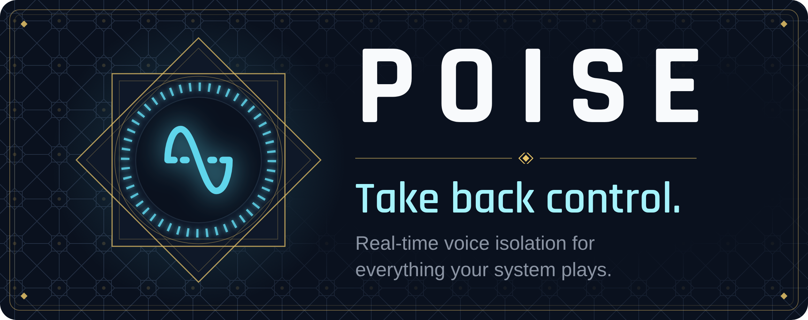
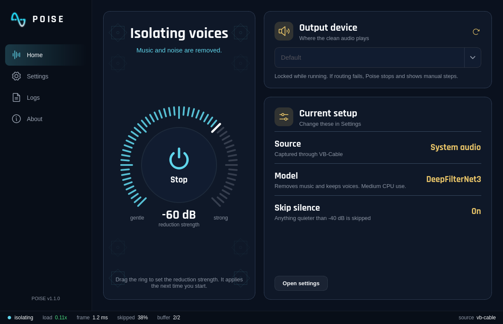

<div align="center">

</div>


<div align="center">

[](https://github.com/chabandou/poise-voice-isolator/releases)
[](https://github.com/chabandou/poise-voice-isolator/releases)
[-3DDC84?style=for-the-badge&logo=android&logoColor=white)](https://github.com/chabandou/poise-android/releases)

</div>


<div align="center">

[](https://www.python.org/)
[](LICENSE)
[](https://github.com/chabandou/poise-voice-isolator)
[](https://github.com/chabandou/poise-voice-isolator)

</div>


<div align="center">
<picture>
  <source media="(prefers-color-scheme: light)" srcset="stream_denoiser/gui/assets/calligraphy_bismillah_black.png">
  <source media="(prefers-color-scheme: dark)" srcset="stream_denoiser/gui/assets/calligraphy_bismillah.png">
  
</picture>
</div>

# Poise Voice Isolator

A high-performance real-time system audio denoiser and voice isolator that captures system audio, processes it through an ONNX neural network model, and outputs enhanced audio with minimal latency.



---

## Navigation

- [For Users](#for-users)
  - [Why Poise?](#why-poise)
  - [Features](#features)
  - [Installation](#installation)
  - [Troubleshooting](#troubleshooting)
- [For Developers](#for-developers)
  - [Installation from Source](#installation-from-source)
  - [Usage](#usage)
  - [Available Options](#available-options)
  - [Models](#models)
  - [Package Structure](#package-structure)
  - [Processing Flow](#processing-flow)
  - [Model Requirements](#model-requirements)
- [Special Thanks](#special-thanks)
- [License](#license)
- [Contributing](#contributing)

---

## For Users

### Why Poise?

Poise is a real-time audio filter that runs in the background while you browse, stream, or work. Simply enable it and let it automatically remove music and background noise from everything you hear - YouTube, social media, podcasts, live streams, and more.

**Key Benefits:**

- **Enable & Forget** - Turn it on once and it continuously processes all system audio in real-time
- **Instant Music Removal** - Automatically strips out music and instrumentals while preserving speech and vocals from any source
- **100% Private & Local** - All processing happens on your machine. Your audio never leaves your computer. Zero cloud dependencies. No tracking, no telemetry.
- **Halal-Friendly Alternative** - For those who practice Islamic values, easily remove musical content while preserving speech and spoken word from any online content
- **Real-time Processing** - Processes audio as it plays with only ~10ms latency, unnoticeable to the user
- **Works Everywhere** - Automatically filters system audio whether you're watching YouTube, streaming content, on video calls, or listening to podcasts
- **Completely Free & Open Source** - MIT licensed. No subscriptions. No hidden costs.

### Features

| Feature | Description |
|---------|-------------|
| **Voice Isolation** | Removes music and instrumentals, keeps only vocals and speech |
| **Real-time Processing** | Direct time-domain processing with ~10ms frame latency |
| **Audio Activity Detection** | Performance boost by skipping silence and non-speech sections |
| **Low Latency** | Blocking sounddevice I/O with ~10ms frames |
| **WASAPI Capture** | Captures system audio on Windows via VB Cable (regular WASAPI input) |
| **VB Cable Integration** | Automatic Windows audio device switching for seamless capture |

### Installation

| Platform | Status |
|----------|--------|
|  | Full Support |
|  | Full Support |
|  | SAMSUNG ONLY [(poise-android)](https://github.com/chabandou/poise-android) |

#### Windows

Download `Poise_Setup.exe` from the
[latest release](https://github.com/chabandou/poise-voice-isolator/releases/latest)
and run it.

> **"Windows protected your PC"?** The installer is not code-signed yet,
> so SmartScreen does not recognise it. Click **More info**, then
> **Run anyway**.

Setup is a single Poise-branded window: choose a location (or keep the
default), press **Install**, and it copies the app, registers the
uninstaller and sets up audio without any further prompts. If Poise is
already installed, the same window offers to update it in place.

The installer bundles the VB-Cable driver (by VB-Audio,
https://vb-audio.com/Cable/ — donationware, consider supporting them)
and installs it automatically when CABLE endpoints are missing
(silent install, reboot afterwards if asked). No manual download needed.

Portable runs: if VB-Cable is missing at startup, the error dialog
offers a one-click **Install VB-Cable** using the copy shipped beside
`Poise.exe` (`vbcable\`), falling back to the VB-Audio website.

#### Linux Binary

Download the prebuilt binary for the TUI directly from GitHub:

```bash
# Download the latest release
curl -L -o poise https://github.com/chabandou/Poise-Voice-Isolator/releases/latest/download/poise

# Make it executable
chmod +x poise

# Move to your PATH (optional)
sudo mv poise /usr/local/bin/

# Run the TUI
poise
```

Or on **Arch Linux**, from the [AUR](https://aur.archlinux.org/packages/poise-bin) (with an AUR helper such as `yay` or `paru`):

```bash
yay -S poise-bin

# Run the TUI
poise
```

### Troubleshooting

#### No audio devices found

- Run `python -m stream_denoiser --list-devices` to see available devices
- On Windows, ensure VB Cable is installed (CABLE Output must be visible)

#### High latency

- Lower `POISE_PW_MARGIN_MS` (Linux) or `POISE_WIN_MARGIN_MS` (Windows): the margin adds directly to the fixed delay, but frames that miss it play unprocessed
- Ensure AAD is enabled to reduce processing load
- Check that your system can process frames faster than real-time (RTF < 1.0)

#### Audio dropouts

- Reduce processing load (enable AAD, reduce model complexity)
- Check system CPU usage and close unnecessary applications, the model can be resource hungry.

#### Linux Troubleshooting

Run the built-in doctor first — it detects the issues below automatically:

```bash
python -m stream_denoiser --doctor
```

Normal startup also runs a fast pre-flight for these (bypass with
`--no-health-check` or `POISE_SKIP_HEALTH=1`).

##### Error: `cannot enable executable stack as shared object requires: Invalid argument`

**Fix (automatic):**

```bash
python -m stream_denoiser --fix-execstack
```

This clears the flag with `patchelf` (installed automatically with the
hints below if missing). Manual fallback:

Clear the executable stack flag on the ONNX Runtime library using `execstack` or `patchelf`.

1. Install `patchelf`:

   ```bash
   sudo pacman -S patchelf    # Arch Linux
   sudo apt install patchelf  # Ubuntu/Debian
   ```

2. Locate the `onnxruntime` shared object file and clear the flag:

   ```bash
   # Find the path (example path for conda environment 'poise')
   find ~/miniforge3/envs/poise/lib/ -name "onnxruntime_pybind11_state.so"
   
   # Apply the fix
   patchelf --clear-execstack /path/to/onnxruntime_pybind11_state.so
   ```

---

##### No audio output or echo/duplicate audio

The denoiser automatically routes system audio through its own sink
(**Poise Voice Isolator** with PipeWire, `Poise_Capture` otherwise). If audio isn't working:

1. **Reset routing in one command:**

   ```bash
   python -m stream_denoiser --reset-audio
   ```

   This restores your real default sink and unloads leftover Poise sinks.
   Manual equivalents follow.

2. **Check current default sink:**
   ```bash
   pactl get-default-sink
   ```
3. **If stuck on `Poise_Capture` after a crash:**

   ```bash
   pactl set-default-sink alsa_output.pci-0000_00_1f.3.analog-stereo
   ```

   (Replace with your actual sink name from `pactl list sinks short`)

4. **Remove leftover null sink:**
   ```bash
   pactl unload-module module-null-sink
   ```

---

## For Developers

### Installation from Source

Recommended to be done in a separate conda environment.

```bash
conda create -n poise python=3.10
conda activate poise
```

1. Clone the repository:

```bash
git clone https://github.com/chabandou/poise-voice-isolator.git
cd poise-voice-isolator
```

2. Install required dependencies:

```bash
pip install onnxruntime numpy sounddevice scipy PyQt6

# For better resampling performance (optional):
pip install samplerate
```

3. Linux: build the PipeWire node (needs a C compiler and the PipeWire
   headers: `pipewire` on Arch, `libpipewire-0.3-dev` on Debian/Ubuntu).
   Without it Poise falls back to the pulse-simple backend.

```bash
make -C native/poise_pw    # -> stream_denoiser/native/libpoise_pw.so
```

4. Windows: the native audio path, `poise_wasapi.dll` (CABLE Output to
   the speakers with a fixed delay, on an MMCSS thread). Cross-compiled
   with mingw-w64 like `rnnoise.dll`; without it Poise falls back to
   PortAudio streams (`POISE_BACKEND=portaudio` forces that).

```bash
make -C native/poise_wasapi    # -> stream_denoiser/native/poise_wasapi.dll
```

   Both native paths compile the same fixed-delay core,
   `native/core/poise_core.c`, into their library.

   To measure the delay on real devices (not in a VM: virtual audio
   timing there is nothing like a sound card's), `native/latmeter` plays
   noise into CABLE Input the way a video player does and records the
   speakers; `tools/win_latency.py` runs Poise beside it under chosen
   load and reports the A/V offset over time, split at CABLE Output.

```bash
make -C native/latmeter        # -> build/latmeter.exe
python tools/win_latency.py run --backend wasapi-proc --phases idle:60,cpu:60
```

#### Usage

##### CLI Mode

Process system audio with default settings (AAD enabled, automatic audio device switching):

```bash
# Using the modular package (recommended)
python -m stream_denoiser

# Or using the entry point script
python -m stream_denoiser.cli
```

### Available Options

- `--model`: Denoising engine — `deepfilternet3` (default, music/voice isolation), `gtcrn` (tiny speech-denoising model, light on CPU, lower delay) or `rnnoise` (light noise suppression, same model as EasyEffects)
- `--onnx`: Path to ONNX model file (deepfilternet3 only, default: the vendored `stream_denoiser/models/denoiser_model_df3.onnx`)
- `--input-device`: Input device ID for system audio capture
- `--output-device`: Output device ID for audio playback
- `--no-aad`: Disable Audio Activity detection
- `--aad-threshold`: AAD threshold in dB (default: -40.0, lower = more sensitive)
- `--atten-lim-db`: Attenuation limit in dB (default: -60.0)
- `--list-devices`: List all available audio devices and exit
- `--no-vb-cable`: Disable automatic VB Cable switching (use current default device). On Linux, keeps the default sink as it is; route apps to the Poise sink yourself
- `--vb-cable-name`: Custom name for VB Cable device (auto-detected if not specified)
- `--backend`: `auto` (default; the PipeWire node on Linux, the native WASAPI path on Windows, when available), `pipewire` or `pulse` (Linux), `wasapi` or `portaudio` (Windows). Also `POISE_BACKEND`
- `POISE_PW_MARGIN_MS` (environment): extra time each frame gets on the PipeWire node before it plays unprocessed (default 21 ms; adds to the fixed delay)
- `POISE_WIN_MARGIN_MS` (environment): the same on the Windows native path

### Models

- **deepfilternet3** (default): DeepFilterNet3 (`denoiser_model_df3.onnx` + states, vendored in `stream_denoiser/models/`). Removes music and keeps vocals/speech, 512-sample frames. RTF ~0.12 (Windows, Ryzen 5 4500U laptop on AC). No extra install.

  The vendored file is the original DF3 export rewritten by `tools/optimize_df3.py` into an equivalent graph (same inputs, outputs and states; output within 3e-7 of the original's) that runs ~15% faster: its inverse FFT was a 4.2 MB matrix product, now two small MatMuls. The script rebuilds the file from the original (`git show 05c081a:stream_denoiser/models/denoiser_model_df3.onnx`, checked by SHA-256) and needs the `onnx` package; Poise itself does not.
- **gtcrn**: [GTCRN](https://github.com/Xiaobin-Rong/gtcrn) (`gtcrn.onnx`, 248 KB, vendored; the model Poise for Android uses), an ultra-lightweight speech-enhancement network. It runs at 16 kHz: each 768-sample frame (16 ms) is low-passed and decimated to 16 kHz, enhanced one STFT hop at a time, and interpolated back, so its output stops at ~7.6 kHz. Removes broadband noise about as well as DeepFilterNet3, but like RNNoise it does *not* remove music. Its model delay is 18 ms (DeepFilterNet3: 32 ms), so Poise's total delay is ~9 ms lower. Light on CPU: RTF ~0.04, vs ~0.12 for DeepFilterNet3 and ~0.08 for the bundled rnnoise.dll (Windows, Ryzen 5 4500U laptop on AC). No extra install.

  The vendored file is upstream's streaming export rewritten by `tools/optimize_gtcrn.py` into an equivalent graph (same inputs, outputs and caches; output within 1e-6 of upstream's) that ONNX Runtime runs ~2.2x faster: at this size its per-operator overhead, not the arithmetic, sets the cost. The script rebuilds the file from upstream's `gtcrn.onnx` (checked by SHA-256) and needs the `onnx` package; Poise itself does not.
- **rnnoise**: lightweight stationary-noise suppression using the system `librnnoise` (same model EasyEffects uses). Low CPU, no model download — but it does *not* remove music. Good for fans, hiss, and weak machines.

```bash
# DeepFilterNet3 mode (faster)
python -m stream_denoiser --model deepfilternet3

# Tiny speech-denoising model (light on CPU, leaves music in)
python -m stream_denoiser --model gtcrn

# Light noise-suppression mode
python -m stream_denoiser --model rnnoise

# TUI with RNNoise (press `m` to switch models)
poise --model rnnoise
```

> **Linux note:** the RNNoise engine needs the `rnnoise` package, e.g. `sudo pacman -S rnnoise` on Arch or `sudo apt install librnnoise0` on Ubuntu/Debian.

##### GUI Mode (Windows only)

```bash
# Run the Poise Voice Isolator GUI
python -m stream_denoiser.gui
```

##### TUI Mode (Linux only)

```bash
# Run the Poise Voice Isolator TUI
python -m stream_denoiser.tui
```

### Package Structure

```
stream_denoiser/
├── tui/                     # Terminal UI (Linux)
│   ├── __init__.py
│   ├── __main__.py          # TUI entry point
│   ├── app.py               # Main Textual app
│   ├── styles.tcss          # TUI stylesheet
│   └── widgets/             # TUI components
│       ├── device_list.py   # Device selection widget
│       ├── stats_panel.py   # Statistics display
│       └── status_line.py   # Status bar widget
├── gui/                     # Desktop GUI (Windows, PyQt6)
│   ├── __init__.py
│   ├── __main__.py
│   ├── assets/              # Icons and images
│   ├── widgets/             # Custom UI components
│   ├── main_window.py
│   ├── settings.py
│   ├── styles.py
│   ├── system_tray.py
│   └── worker.py            # Audio processing thread
├── models/                  # Vendored models: DeepFilterNet3 (.onnx + states .npz), GTCRN (.onnx)
├── backends/                # Audio interface backends
│   ├── pipewire_backend.py  # Linux: Poise as a PipeWire node (default)
│   ├── pipewire_node.py     # ctypes binding for libpoise_pw.so (native/poise_pw)
│   ├── pulse_backend.py     # Linux fallback: pulse-simple loop
│   ├── wasapi_backend.py    # Windows: native WASAPI path (default)
│   ├── wasapi_node.py       # ctypes binding for poise_wasapi.dll (native/poise_wasapi)
│   ├── delay_core.py        # ctypes side of poise_core (native/core), shared by both native nodes
│   ├── node_loop.py         # Inference thread for either native node
│   ├── sounddevice_backend.py # Windows fallback: PortAudio loop (VB Cable)
│   └── platform/            # Platform-specific code
│       ├── linux.py         # PulseAudio integration
│       └── windows.py       # WASAPI support, VB-Cable switching
├── processor.py             # Core ONNX model wrapper
├── aad.py                   # Audio Activity Detection
├── resampler.py             # Audio resampling
├── device_utils.py          # Audio device utilities
├── platform_utils.py        # Platform detection
├── constants.py             # Global configurations
├── session.py               # Builds the processor, runs the chosen loop
├── audio_host.py            # The GUI/TUI's audio process
├── cli.py                   # Command-line interface
├── logging_config.py        # Logging configuration
├── backend_detection.py     # Backend availability checks
├── __init__.py
└── __main__.py
```

### Processing Flow

```
┌─────────────────┐
│  System Audio   │
│    (Input)      │
└────────┬────────┘
         │
         ▼
┌─────────────────┐
│ Input Buffer    │
│ (Ring Buffer)   │
└────────┬────────┘
         │
         ▼
┌─────────────────┐
│ Resampler       │◄─── Convert to 48kHz if needed
│ (if needed)     │
└────────┬────────┘
         │
         ▼
┌─────────────────┐
│ Frame Splitter  │◄─── Engine frame size @ 48kHz (deepfilternet3: 512, gtcrn: 768, rnnoise: 480)
└────────┬────────┘
         │
         ▼
┌─────────────────┐
│ AAD Check       │◄─── Skip processing if silence
│ (optional)      │
└────────┬────────┘
         │
         ▼
┌─────────────────┐
│ ONNX Inference  │◄─── Denoiser model processing
│ (with state)    │
└────────┬────────┘
         │
         ▼
┌─────────────────┐
│ Post-processing │◄─── Normalize, clip, remove DC
└────────┬────────┘
         │
         ▼
┌─────────────────┐
│ Output Buffer   │
│ (Ring Buffer)   │
└────────┬────────┘
         │
         ▼
┌─────────────────┐
│  Audio Output   │
│   (Speakers)    │
└─────────────────┘
```

### Model Requirements

The ONNX model should have the following interface:

### Inputs

- `input_frame`: Float32 array of shape `[512]` (512 samples @ 48kHz)
- 12 state tensors (norm states, STFT overlap buffers, GRU hidden states —
  see `stream_denoiser/models/denoiser_model_df3_states.npz` for shapes)

### Outputs

- `enhanced_audio_frame`: Float32 array of shape `[512]`
- 12 updated state tensors (`new_<input_name>`, in input order)

### Statistics

During processing, the script/GUI displays real-time statistics:

- **RTF**: Real-time factor (processing time / frame duration, <1.0 means real-time capable)
- **Avg**: Average processing time per frame in milliseconds
- **AAD bypass**: Percentage of frames skipped due to silence (the GUI's status bar instead shows `skip on/off`: whether it is skipping right now)
- **Buffer status**: Input/output buffer fill levels

##### Audio routing (how it works)

On Linux with PipeWire (the default on current distributions), Poise runs
inside PipeWire's processing graph, the way EasyEffects and PipeWire's own
filter-chain do:

1. Adds a virtual sink, **Poise Voice Isolator** (`Poise_Isolator`), and makes it the default (apps send audio there)
2. Processes each graph cycle's input and hands the output to your real speakers in the same cycle
3. Keeps the delay between the two fixed (about 76 ms with DeepFilterNet3, 67 ms with GTCRN) and reports it to PipeWire, so video players can hold the picture back to match
4. Restores the original default on exit; if Poise is killed, the sink disappears with it

If a frame isn't processed in time, that moment plays unprocessed (and the
log counts it as `dry`) instead of the audio falling behind the video.

Without PipeWire (or with `--backend pulse` / `POISE_BACKEND=pulse`), Poise
uses the pulse-simple path instead: it creates a null sink
(`Poise_Capture`), makes it the default, captures from its monitor, and
plays the processed audio to your speakers.

On Windows, Poise makes VB-Cable's **CABLE Input** the default playback
device, captures **CABLE Output** and plays the processed audio to your
speakers or headphones. VB-Cable ignores CABLE Input's own volume control,
so while Poise runs it mirrors that control onto the output device: the
volume keys, the taskbar slider and mute work as usual, and the output
device keeps the level you leave it at when Poise stops.

## Special Thanks

DeepFilterNet (Rikorose) for the [DeepFilterNet3 model](https://github.com/Rikorose/DeepFilterNet).

Mozilla/Xiph for [RNNoise](https://github.com/mozilla/rnnoise).

Xiaobin Rong for the [GTCRN model](https://github.com/Xiaobin-Rong/gtcrn) (MIT; `gtcrn.onnx` is its official streaming export, rewritten into an equivalent, faster graph by `tools/optimize_gtcrn.py`).

yuyun2000 for the speech enhancement [model](https://github.com/yuyun2000/SpeechDenoiser).

## License

MIT License

## Contributing

I have no specific method of contribution, but I'm open to ideas, and all contributions are welcome.

<div align="center">

### Made with care by Chabandou

[Star us on GitHub](https://github.com/chabandou/poise-voice-isolator) · [Report Bug](https://github.com/chabandou/poise-voice-isolator/issues) · [Request Feature](https://github.com/chabandou/poise-voice-isolator/issues)

</div>
