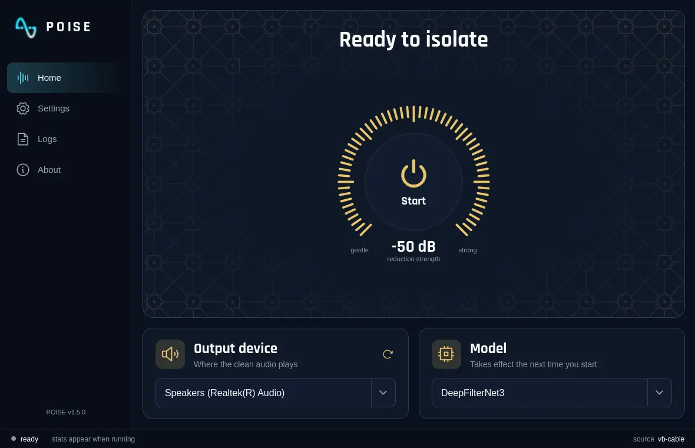
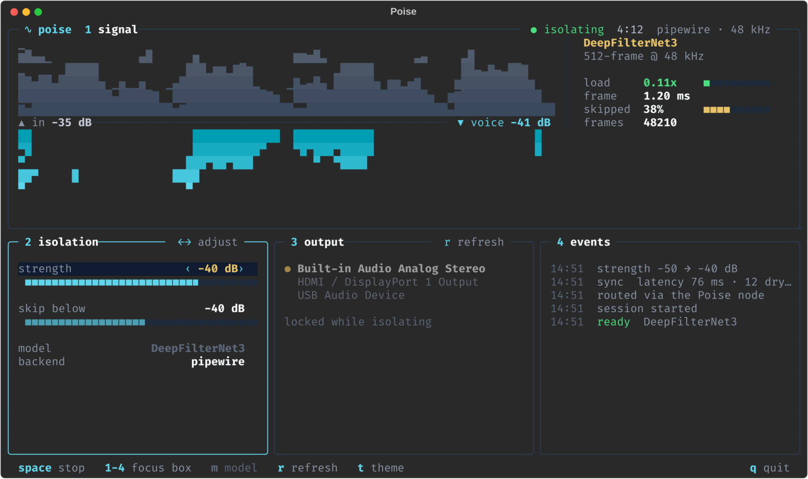
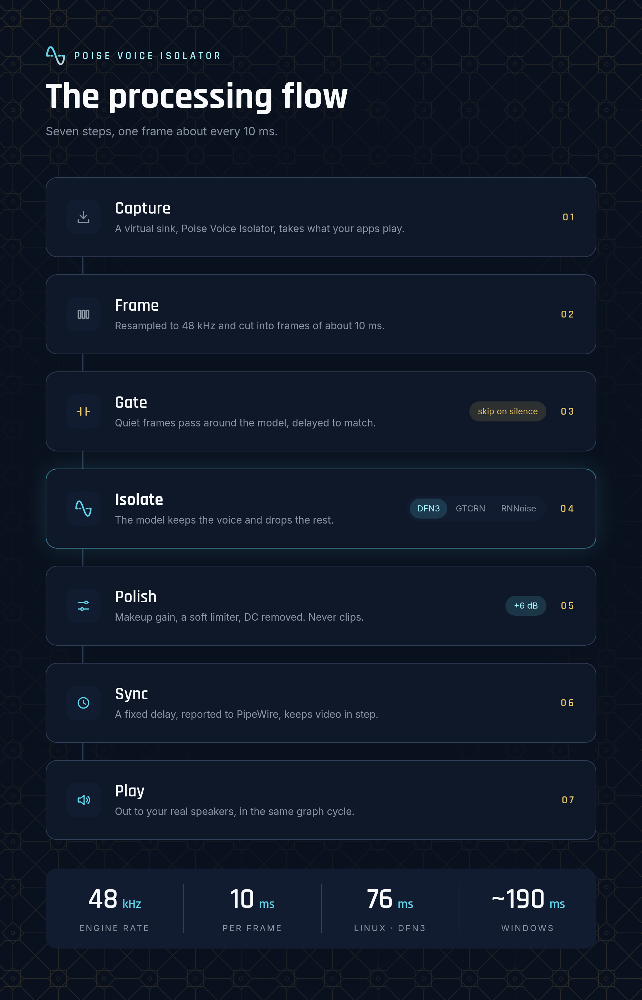
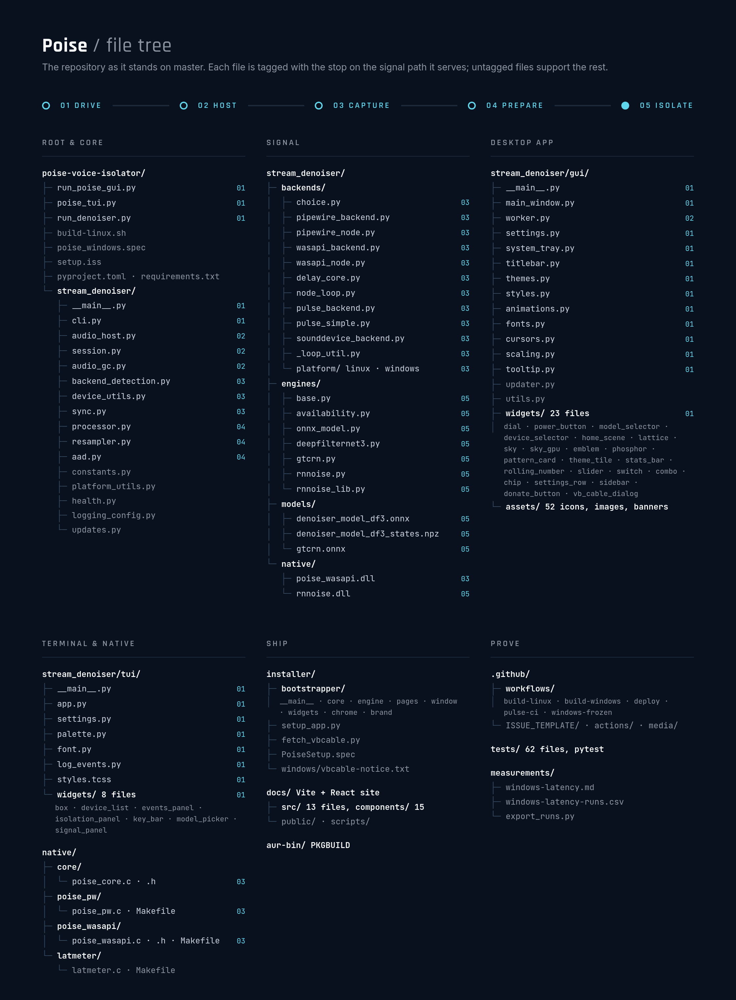

<div align="center">

</div>


<div align="center">

[](https://github.com/chabandou/poise-voice-isolator/releases)
[](https://github.com/chabandou/poise-voice-isolator/releases)
[-3DDC84?style=for-the-badge&logo=android&logoColor=white)](https://github.com/chabandou/poise-android/releases)

</div>


<div align="center">

[](https://www.python.org/)
[](LICENSE)
[](https://github.com/chabandou/poise-voice-isolator)
[](https://github.com/chabandou/poise-voice-isolator)

</div>


<div align="center">
<picture>
  <source media="(prefers-color-scheme: light)" srcset="stream_denoiser/gui/assets/calligraphy_bismillah_black.png">
  <source media="(prefers-color-scheme: dark)" srcset="stream_denoiser/gui/assets/calligraphy_bismillah.png">
  
</picture>
</div>

<h1 align="center">Poise Voice Isolator</h1>

<p align="center">
  <b>Real-time voice isolation for everything your computer plays.</b><br/>
  <sub>Music and noise out, speech in. Local, open source, in sync with the picture.</sub>
</p>

<p align="center">
  <a href="https://github.com/chabandou/poise-voice-isolator/releases/latest"><b>Download</b></a> ·
  <a href="https://chabandou.github.io/poise-voice-isolator/">Website</a> ·
  <a href="#install">Install</a> ·
  <a href="#models">Models</a> ·
  <a href="#how-it-works">How it works</a> ·
  <a href="#troubleshooting">Troubleshooting</a> ·
  <a href="#development">Development</a>
</p>



Poise sits between your apps and your speakers. It takes the system mix (YouTube, streams, podcasts), runs it through a neural speech model, and plays back only the voices. Turn it on once and forget it.

- **Strips music, keeps speech.** DeepFilterNet3 removes instrumentals and background noise while leaving voices intact. A halal-friendly way to watch and listen to online content.
- **Stays in sync.** The delay is fixed and reported to the audio server, so video players hold the picture to match: 76 ms end to end on Linux.
- **Light on the machine.** Silence skips the model entirely. Inference runs at ~0.12× real time on a laptop CPU, or ~0.04× with GTCRN.
- **Private by construction.** Everything runs on your machine. No cloud, no account, no telemetry.
- **Free.** MIT licensed, no subscription.

> [!NOTE]
> On Android, Poise lives in a separate app for Samsung devices: [poise-android](https://github.com/chabandou/poise-android).

## Install

### Windows

Download **`Poise_Setup.exe`** from the [latest release](https://github.com/chabandou/poise-voice-isolator/releases/latest) and run it. Pick a folder (or keep the default) and press **Install**. The same window updates an existing install in place, and the app updates itself after that.

> [!WARNING]
> The installer is not code-signed yet, so SmartScreen shows **"Windows protected your PC"**. Click **More info → Run anyway**.

> [!TIP]
> Setup bundles and silently installs the [VB-Cable](https://vb-audio.com/Cable/) driver when it is missing (reboot if asked). VB-Cable is donationware by VB-Audio; consider supporting them. Portable runs offer a one-click **Install VB-Cable** from the copy beside `Poise.exe`.

### Linux

Arch Linux, from the [AUR](https://aur.archlinux.org/packages/poise-bin):

```bash
yay -S poise-bin
```

Any distribution, as a single binary:

```bash
curl -L -o poise https://github.com/chabandou/poise-voice-isolator/releases/latest/download/poise
chmod +x poise && sudo mv poise /usr/local/bin/
```

Then run `poise` to open the terminal UI. All three models are built in.

<details>
<summary><b>Terminal UI preview</b></summary>
<br/>

</details>

## Models

Switch with `m` in the TUI, the **Model** card in the app, or `--model` on the command line.

| Model | Engine delay | Load (RTF) | Best for |
|:--|:--:|:--:|:--|
| **DeepFilterNet3** *(default)* | 32 ms | ~0.12 | Voice isolation from music and noise |
| **GTCRN** | 18 ms | ~0.04 | Noisy speech on weak CPUs, lowest delay |
| **RNNoise** | 20 ms | ~0.08 | Steady noise: fans, hiss, hum |

<sub>RTF = processing time ÷ audio time, measured on a Ryzen 5 4500U laptop on AC. Below 1.0 keeps up with real time.</sub>

<details>
<summary><b>Model notes</b></summary>

- **DeepFilterNet3** works on 512-sample frames at 48 kHz. The vendored `denoiser_model_df3.onnx` is the original export rewritten by `tools/optimize_df3.py` into an equivalent graph (output within 3e-7) that runs ~15% faster: the inverse FFT, a 4.2 MB matrix product, became two small MatMuls.
- **GTCRN** ([upstream](https://github.com/Xiaobin-Rong/gtcrn), 248 KB, also used by Poise for Android) runs at 16 kHz: each 16 ms frame is low-passed, decimated, enhanced one STFT hop at a time and interpolated back, so its output stops at ~7.6 kHz. `tools/optimize_gtcrn.py` rewrites upstream's streaming export into an equivalent graph (output within 1e-6) that runs ~2.2× faster, since at this size per-operator overhead, not arithmetic, sets the cost.
- **RNNoise** is the same model EasyEffects uses, bundled as `librnnoise.so` / `rnnoise.dll`.

Both rewrite scripts rebuild their file from the original (checked by SHA-256) and need the `onnx` package. Poise itself does not.

</details>

## How it works



| Platform | Route | End to end |
|:--|:--|:--:|
| **Linux · PipeWire** *(default)* | A **Poise Voice Isolator** sink becomes the default; a native node inside PipeWire's graph processes each cycle and hands it to your speakers | ~76 ms |
| **Linux · Pulse** *(fallback)* | A `Poise_Capture` null sink becomes the default; Poise records its monitor and plays to your speakers | varies |
| **Windows** | **CABLE Input** becomes the default; a native WASAPI path on an MMCSS thread carries **CABLE Output** to your speakers | ~190 ms |

> [!NOTE]
> A frame that misses its deadline plays **unprocessed** rather than late, so audio never drifts behind the video (the log counts these as `dry`). Your original default device comes back on exit, and if Poise is killed, its PipeWire sink disappears with it. On Windows, Poise mirrors CABLE Input's volume onto your real device, so volume keys and mute keep working.

## Troubleshooting

On Linux, start with the built-in doctor. It checks the audio server and the PipeWire node and says what to do (a quick version also runs at every start):

```bash
poise --doctor
```

<details>
<summary><b>No sound, or doubled audio</b></summary>

**Linux:** restore your real default output and remove leftover Poise sinks, for example after a crash:

```bash
poise --reset-audio
```

**Windows:** Poise needs VB-Cable. If **CABLE Output** is missing from your recording devices, run `Poise_Setup.exe` again, or use **Install VB-Cable** in the error dialog.

</details>

<details>
<summary><b>Dropouts or unprocessed moments</b></summary>

- Switch to **GTCRN**: about a third of DeepFilterNet3's CPU load.
- Keep **Skip silence** on (the default).
- Close heavy background apps; the **load** readout should stay well below 1.0.

</details>

<details>
<summary><b>Advanced: trade delay for headroom</b></summary>

Each frame gets a fixed deadline; a frame that misses it plays unprocessed. The margin adds directly to the delay, so raise it for fewer misses or lower it for less delay:

```bash
POISE_PW_MARGIN_MS=30 poise      # Linux, default 21
```

On Windows, set `POISE_WIN_MARGIN_MS` as a user environment variable and restart Poise.

</details>

## Development

### From source

```bash
git clone https://github.com/chabandou/poise-voice-isolator.git
cd poise-voice-isolator
conda create -n poise python=3.10 && conda activate poise

pip install -e ".[linux]"   # TUI: textual, pulsectl
pip install -e ".[gui]"     # desktop app: PyQt6
```

| Run | Command |
|:--|:--|
| Terminal UI (Linux) | `poise` · `python -m stream_denoiser.tui` |
| Desktop app (Windows) | `python -m stream_denoiser.gui` |
| Headless CLI | `poise-cli` · `python -m stream_denoiser` |
| Tests | `pytest` (live-audio tests are marked `integration`) |

> [!NOTE]
> On newer glibc, a pip-installed ONNX Runtime may fail with `cannot enable executable stack as shared object requires`. `poise --fix-execstack` clears the flag with `patchelf`. Release binaries ship already patched.

### Native audio paths

Both compile the same fixed-delay core, `native/core/poise_core.c`. Without them Poise falls back to the pulse-simple loop (Linux) or PortAudio streams (Windows).

```bash
make -C native/poise_pw        # Linux:   stream_denoiser/native/libpoise_pw.so (needs PipeWire headers)
make -C native/poise_wasapi    # Windows: stream_denoiser/native/poise_wasapi.dll (mingw-w64)
```

> [!TIP]
> To measure real A/V offset (on hardware, not a VM), `native/latmeter` plays noise into CABLE Input the way a video player does and records the speakers; `tools/win_latency.py` runs Poise beside it under load:
> ```bash
> make -C native/latmeter
> python tools/win_latency.py run --backend wasapi-proc --phases idle:60,cpu:60
> ```

<details>
<summary><b>TUI themes</b></summary>

Press `t` to cycle `abyss` (default), `verdant`, `mono`, `ultraviolet`, `ember`, `orchid`. The choice is saved in `$XDG_CONFIG_HOME/poise/tui.json` (usually `~/.config/poise/tui.json`), where any color can be overridden on top of the theme:

```json
{
  "theme": "ember",
  "colors": { "accent": "#ff8800", "border": "#3a3a3a" }
}
```

Values are hex, `rgb(...)` or color names. Roles: `accent`, `accent_dim`, `voice_light`, `highlight`, `text`, `soft`, `muted`, `dim`, `border`, `groove`, `selection`, `scope_in`, `surface`, `on_accent`, `scrim`, `ok`, `warn`, `error`. Setting `accent` alone also shades `accent_dim` and `voice_light`. Invalid values are skipped and reported in the events box. A running TUI picks up changes to the file within a second, so a wallpaper-palette hook (e.g. a Noctalia or matugen template) can recolor it live.

</details>

<details>
<summary><b>Readouts</b></summary>

| Readout | Meaning |
|:--|:--|
| **load** | Real-time factor; below 1.0 keeps up |
| **frame** | Average inference time per frame |
| **skipped** | Share of frames bypassed as silence |
| **dry** | Frames that missed their deadline and played unprocessed |

</details>

<details>
<summary><b>DeepFilterNet3 model interface</b></summary>

A replacement passed with `--onnx` must match:

- **Inputs:** `input_frame`, float32 `[512]` (512 samples at 48 kHz), plus 12 state tensors (norm states, STFT overlap buffers, GRU hidden states; shapes in `stream_denoiser/models/denoiser_model_df3_states.npz`).
- **Outputs:** `enhanced_audio_frame`, float32 `[512]`, plus the 12 updated states as `new_<input_name>`, in input order.

</details>

### Layout

<a href="https://chabandou.github.io/poise-voice-isolator/repo/"></a>

**[Explore the interactive map](https://chabandou.github.io/poise-voice-isolator/repo/)**  → Hover a file for what it does, click it to look inside.

<details>
<summary>The same tree as text</summary>

```
stream_denoiser/
├── __main__.py              # python -m stream_denoiser
├── cli.py                   # Command-line interface
├── audio_host.py            # The GUI/TUI's audio process
├── session.py               # Builds the processor, runs the chosen loop
├── audio_gc.py              # Garbage collector paused during a run
├── processor.py             # Engine frames, dry mix, AAD bypass
├── resampler.py             # Streaming resampler to 48 kHz
├── aad.py                   # Audio Activity Detection
├── sync.py                  # Capture backlog guard (pulse-simple fallback)
├── backend_detection.py     # Backend availability checks
├── device_utils.py          # Audio device utilities
├── platform_utils.py        # Platform detection
├── health.py                # Startup health checks and audio recovery (Linux)
├── updates.py               # In-app updates (Windows installs)
├── constants.py             # Global configuration
├── logging_config.py        # Logging configuration
├── backends/                # Audio interface backends
│   ├── choice.py            # Which backend the user asked for
│   ├── pipewire_backend.py  # Linux: Poise as a PipeWire node (default)
│   ├── pipewire_node.py     # ctypes binding for libpoise_pw.so (native/poise_pw)
│   ├── pulse_backend.py     # Linux fallback: pulse-simple loop
│   ├── pulse_simple.py      # ctypes binding for libpulse-simple
│   ├── wasapi_backend.py    # Windows: native WASAPI path (default)
│   ├── wasapi_node.py       # ctypes binding for poise_wasapi.dll (native/poise_wasapi)
│   ├── delay_core.py        # ctypes side of poise_core (native/core), shared by both native nodes
│   ├── node_loop.py         # Inference thread for either native node
│   ├── sounddevice_backend.py # Windows fallback: PortAudio loop (VB Cable)
│   ├── _loop_util.py        # Helpers the loops share
│   └── platform/            # linux.py (PulseAudio), windows.py (WASAPI, VB-Cable switching)
├── engines/                 # Denoise engines
│   ├── base.py              # DenoiseEngine base class
│   ├── availability.py      # Which models can run here
│   ├── onnx_model.py        # ONNX Runtime session and model lookup
│   ├── deepfilternet3.py    # DeepFilterNet3 (ONNX)
│   ├── gtcrn.py             # GTCRN (ONNX, 16 kHz)
│   ├── rnnoise.py           # RNNoise
│   └── rnnoise_lib.py       # ctypes binding for the RNNoise library
├── models/                  # Vendored models: DeepFilterNet3 (.onnx + states .npz), GTCRN (.onnx)
├── native/                  # Prebuilt libraries: poise_wasapi, rnnoise (.so and .dll)
├── gui/                     # Desktop GUI (PyQt6)
│   ├── main_window.py
│   ├── worker.py            # QThread audio worker, signals to the GUI
│   ├── themes.py · styles.py · settings.py · system_tray.py · titlebar.py · updater.py
│   ├── widgets/             # Dial, power button, model and device selectors, lattice, sky…
│   └── assets/              # Icons and images
└── tui/                     # Terminal UI (Textual)
    ├── app.py               # Main Textual app
    ├── styles.tcss          # TUI stylesheet
    └── widgets/             # Device list, signal, isolation and events panels, model picker

native/                      # C sources: core/ (shared delay), poise_pw/, poise_wasapi/, latmeter/
installer/                   # Windows setup app (bootstrapper/), VB-Cable fetch
docs/                        # Website (Vite + React); scripts/render-file-tree.mjs draws the image above
```

</details>

## Reference

<details>
<summary><b>CLI reference</b></summary>

| Option | Effect |
|:--|:--|
| `--model {deepfilternet3,gtcrn,rnnoise}` | Engine (default `deepfilternet3`) |
| `--onnx PATH` | Custom DeepFilterNet3 model file |
| `--backend` | `auto`, `pipewire`, `pulse` (Linux) · `wasapi`, `portaudio` (Windows) |
| `--source` / `--sink` | Pulse capture source / playback sink (Linux) |
| `--input-device` / `--output-device` | Device IDs (Windows) |
| `--list-devices` | List devices and exit |
| `--no-aad` | Process silence too |
| `--aad-threshold DB` | Skip below this level (default −40; lower is more sensitive) |
| `--atten-lim-db DB` | Reduction strength (default −60) |
| `--no-vb-cable` | Leave the default device alone; route apps yourself |
| `--vb-cable-name NAME` | VB-Cable device name, if not auto-detected |
| `--doctor` · `--reset-audio` · `--fix-execstack` | Linux repair tools |

</details>

<details>
<summary><b>Environment variables</b></summary>

| Variable | Effect |
|:--|:--|
| `POISE_BACKEND` | Same as `--backend` |
| `POISE_PW_MARGIN_MS` · `POISE_WIN_MARGIN_MS` | Per-frame deadline margin; adds to the delay |
| `POISE_ONNX_THREADS` | Inference threads (default 2 on Linux, 1 on Windows) |
| `POISE_SKIP_HEALTH=1` | Skip the startup pre-flight |
| `POISE_LOG_LEVEL` · `POISE_LOG_DIR` · `POISE_DISABLE_FILE_LOG=1` | Logging |
| `POISE_UI_SCALE` · `POISE_REDUCE_MOTION=1` | Desktop app scale and motion |

</details>

## Credits

| | |
|:--|:--|
| [DeepFilterNet3](https://github.com/Rikorose/DeepFilterNet) | Hendrik Schröter (Rikorose) |
| [GTCRN](https://github.com/Xiaobin-Rong/gtcrn) | Xiaobin Rong (MIT; official streaming export) |
| [RNNoise](https://github.com/xiph/rnnoise) | Xiph.Org / Mozilla |
| [SpeechDenoiser](https://github.com/yuyun2000/SpeechDenoiser) | yuyun2000 |
| [VB-Cable](https://vb-audio.com/Cable/) | VB-Audio |

## Contributing

There is no formal process yet. Issues, ideas and pull requests are all welcome.

## License

[MIT](LICENSE)

<div align="center">
<br/>

**Made with care by Chabandou**

[Star on GitHub](https://github.com/chabandou/poise-voice-isolator) · [Report a bug](https://github.com/chabandou/poise-voice-isolator/issues) · [Request a feature](https://github.com/chabandou/poise-voice-isolator/issues)

</div>
